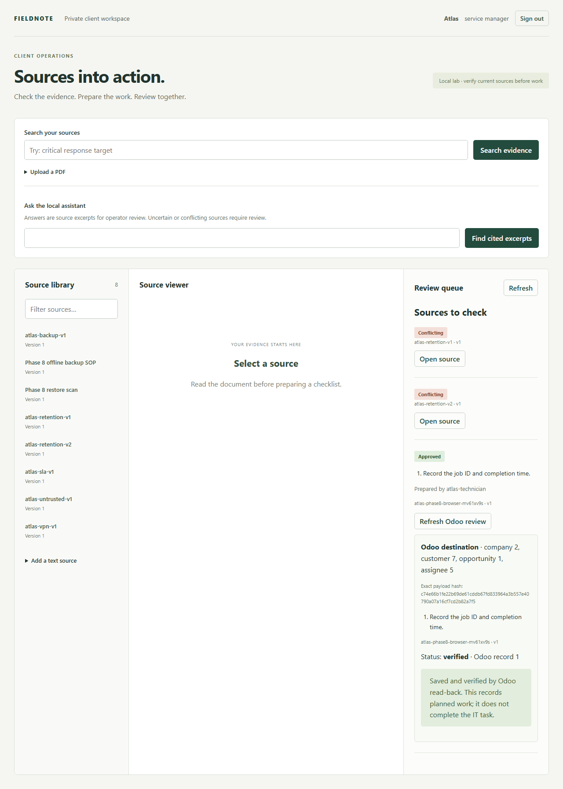
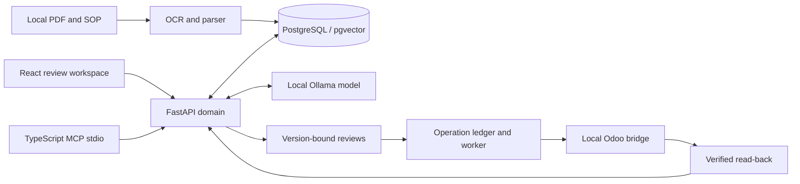

# Private Offline Document Intelligence

[](https://github.com/williamlo90/private-offline-document-intelligence/actions/workflows/ci.yml)

A local document workspace for MSP teams. It searches client contracts and SOPs, answers with page-level sources, flags missing or conflicting evidence, and prepares a checklist for separate human review before saving it to Odoo. The application has no hosted-model fallback.

[Demo walkthrough](docs/DEMO.md) · [Case study](docs/CASE-STUDY.md) · [Operator guide](docs/PHASE-8-DELIVERY.md) · [Documentation](docs/README.md)



The screenshot is from a synthetic single-host lab. The approved checklist records planned work; it does not perform an IT change.

## Why this project

MSP technicians often have to reconcile an SLA, an older exception and a current runbook before answering a client. A fluent answer without the correct document version or client boundary is unsafe. This project makes source provenance, abstention, review and tenant isolation part of the workflow rather than optional prompt instructions.

## Validated results

| Area | Synthetic local-lab result | Evidence |
| --- | --- | --- |
| Connected workflow | One fresh four-service deployment ran scanned-PDF OCR, exact citations, missing-evidence abstention, conflict review, cross-client denial, Chromium UI review, Odoo save/read-back and MCP stdio. | [Phase 8 delivery](docs/PHASE-8-DELIVERY.md), [publication evidence](docs/evidence/phase-8-summary.json) |
| Cold start and recovery | The first sourced answer on fresh volumes took 5.056 s without manually restarting the API. After a full stop/start, the first answer took 17.768 s; documents and the Odoo receipt persisted. App and Odoo database backups restored into disposable clones. | [Phase 8 delivery](docs/PHASE-8-DELIVERY.md) |
| Quality and load | A 13-case synthetic regression passed 7/7 answerable and 6/6 abstain/review cases, with 14/14 fields and citations. A short workload made 20 searches and 7 answers with zero HTTP errors; answer p95 was 30.180 s. | [Phase 7 validation](docs/PHASE-7-PORTFOLIO.md) |
| Network boundary | The application services ran on a Docker internal network with no published host ports. External TCP probes from API, Odoo and Ollama returned `ENETUNREACH`; the browser test blocked non-loopback requests. | [Phase 8 delivery](docs/PHASE-8-DELIVERY.md) |

The 13-case set was used to fix relevance, so it is regression evidence, not a fresh untouched holdout for the final image. Network probes are not a packet capture. All data and Odoo records in these runs are synthetic. The host was not physically air-gapped, and no customer accuracy, production uptime or ROI is claimed.

## Workflow

1. An authorized technician uploads or finds a local PDF. OCR and parsing retain page, version and effective-date provenance.
2. Tenant-scoped retrieval supports a cited answer or a visible review/abstain state for missing, stale or conflicting material.
3. A manager reviews the exact checklist. A separate reviewer authorizes the Odoo destination.
4. The operation ledger protects retries; the Odoo result is read back and audited.



**Stack:** FastAPI/Python, PostgreSQL/pgvector, React/TypeScript, MCP stdio, local OCR/embeddings, Ollama and Odoo. The four [reusable skills](REUSABLE-SKILLS.md) share the same domain controls across API/UI and MCP.

## Try the synthetic workspace

The lightweight memory harness runs without Docker or Odoo. It seeds synthetic sources and demonstrates search, source review and checklist approval; the full Phase 8 integration requires the staged offline assets described in the [operator guide](docs/PHASE-8-DELIVERY.md).

```powershell
python -m venv .venv
.venv/Scripts/python.exe -m pip install -r requirements.lock
npm.cmd ci --prefix frontend
npm.cmd run build --prefix frontend
python scripts/create_lab_profile.py
$env:PRIVATE_LAB_CONFIG = (Resolve-Path local/lab-identities.json).Path
.venv/Scripts/python.exe -m uvicorn backend.main:load_app --factory --host 127.0.0.1 --port 8077 --no-access-log
```

Open `http://127.0.0.1:8077/ui/`. The generated role tokens are in the ignored `local/lab-identities.json`; use different actors to prepare and approve. State in this harness resets on restart. For Linux/macOS, use `.venv/bin/python` and `npm`.

Run `python -m pytest -q`, `npm run build --prefix frontend`, `npm run build --prefix mcp` and `npm run test --prefix mcp` for the portable checks after installing the pinned dependencies. The repository does not contain the multi-gigabyte model/runtime bundle or lab credentials.

## Delivery scope

Phase 0–8 is **offline-delivered in a synthetic local lab**, with pre-provisioned pinned Docker base images and one GPU-capable host. Phase 9 private-cloud hosting is optional and has not been selected or validated. Odoo filestore restore, long-duration reliability, customer production support and physical host air-gap are outside the demonstrated scope. See [security](SECURITY.md), the [phase plan](PHASES.md) and the [case study](docs/CASE-STUDY.md).
